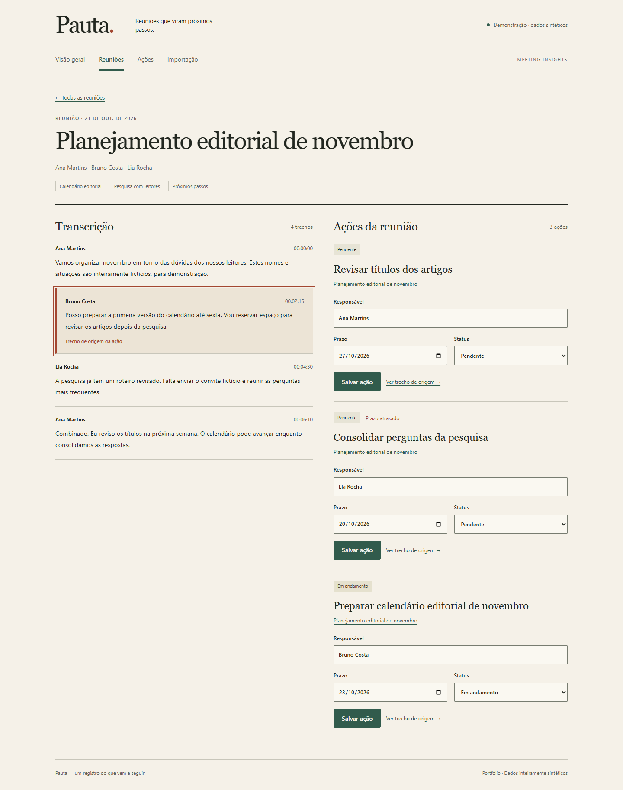

# Pauta — Meeting Insights

Reuniões que viram próximos passos. Um portfólio de React e integração com API: importe reuniões fictícias, consulte a transcrição e acompanhe ações com responsável, prazo, status e trecho de origem.

**Todos os dados são sintéticos.** Temas e ações vêm do JSON importado; não há IA nem transcrição de áudio. O MVP não possui autenticação e destina-se à execução local.

## Iniciar

Pré-requisitos: Node 22.23.2 (também em `.nvmrc`), npm 10+, Docker com Compose ou PostgreSQL 17 local. No PowerShell, use `npm.cmd` se `npm.ps1` estiver bloqueado; não é necessário alterar a política de execução.

```sh
npm ci
cp .env.example .env
docker compose up -d --wait
npm run db:migrate
npm run db:seed
npm run dev
```

No PowerShell, copie com `Copy-Item .env.example .env`. Interface: http://localhost:5178. API: http://localhost:3001/api/health. O Compose expõe o banco apenas em `127.0.0.1:55432`, preservando instalações na porta padrão. O volume persiste os dados após reiniciar o container.

Neste ambiente Windows, a cadeia de certificados da rede exigiu `$env:NODE_USE_SYSTEM_CA = '1'` antes de `npm.cmd ci` e da instalação do Chromium. Essa variável vale para a sessão do terminal, usa os certificados confiáveis do Windows e mantém a validação TLS. Não foi necessário alterar configurações globais ou desativar SSL.

Para PostgreSQL local, crie um banco dedicado e configure `DATABASE_URL`; migrations e seed usam a mesma configuração. Não é necessário Docker nesse caso. O seed é explícito e repetível, sem duplicar identificadores externos.

## Configuração

| Variável | Uso |
| --- | --- |
| `DATABASE_URL` | PostgreSQL de desenvolvimento (obrigatória) |
| `TEST_DATABASE_URL` | PostgreSQL exclusivo de integração, nome terminado em `_test` |
| `PORT` | Porta da API, padrão 3001 |
| `CORS_ORIGIN` | Origem permitida da interface, padrão `http://localhost:5178` |

Nunca versione `.env` nem use credenciais de produção na demonstração. A interface usa `/api` e o proxy Vite durante o desenvolvimento.

## Usar

- Visão geral: indicadores globais de todas as reuniões e gráfico com tabela equivalente.
- Reuniões: busca por título, período e paginação; detalhe com participantes, temas e transcrição.
- Ações: filtros combináveis, edição de responsável/prazo/status e origem acessível na transcrição.
- Importação: baixe o exemplo na interface ou use `fixtures/import-example.json`; erros mostram o campo inválido.

A importação valida o lote inteiro e usa uma transação: erros não deixam registros parciais. Identificador externo já existente rejeita o lote com conflito. O exemplo de importação é diferente do seed. Consulte [contrato e API](docs/API.md) e [OpenAPI](docs/openapi.yaml).

Prazos são datas de calendário (`YYYY-MM-DD`). Atraso usa a data atual em `America/Sao_Paulo`, excluindo ações concluídas. Ações abertas são pendentes + em andamento. Nenhum filtro de listagem altera o escopo global dos indicadores.

## Desenvolvimento e verificações

```sh
npm run lint
npm run typecheck
npm test
npm run build
npm run test:e2e
```

Antes de testes de integração, crie o banco separado no container:

```sh
docker compose exec -T postgres psql -U pauta -d pauta -c "CREATE DATABASE pauta_test"
```

Configure `TEST_DATABASE_URL` conforme `.env.example`. O comando deve ser usado uma única vez; se o banco já existe, preserve-o. Os testes limpam somente o banco de testes após verificar o sufixo `_test`. Para o navegador, instale Chromium com `npx playwright install chromium`. Os E2E usam API e banco reais e criam dados sintéticos próprios; não execute contra produção.

Detalhes e resultados reais: [TESTING](docs/TESTING.md). CI configura instalação por lockfile, lint, typecheck, testes, build, PostgreSQL e E2E. Execução remota será registrada separadamente da configuração.

Validação local: instalação por `npm ci`, lint, typecheck e build passaram; 17 testes API/guard, 14 testes React e 3 E2E passaram, incluindo partida a frio. **GitHub Actions: configurado, execução remota não verificada** — o push foi rejeitado com 403 pela conta Git configurada neste ambiente.

## Como o código funciona

`apps/web` contém React, TypeScript e CSS com tokens próprios. `apps/api` contém Express, validação de entrada e consultas PostgreSQL parametrizadas com `pg`. Mantivemos SQL explícito para tornar transações, filtros e persistência fáceis de explicar. Fixtures são o contrato de importação versionado; React renderiza o texto sem executar HTML importado.

As fontes Georgia e do sistema evitam downloads e dependências de licença de arquivos distribuídos. A identidade editorial usa papel, tinta, verde e terracota; [DESIGN](docs/DESIGN.md) documenta os tokens. Há foco visível, link de salto, mensagens anunciadas e tabela do gráfico. Testes axe não equivalem a certificação WCAG; leitor de tela permanece uma verificação separada.

## Deploy e limites

Para preparar um deploy: execute `npm ci` e `npm run build`; sirva `apps/web/dist` por HTTPS, encaminhe `/api` à API Node, configure `DATABASE_URL`, `PORT` e `CORS_ORIGIN`, execute `npm run db:migrate` e inicie com `node apps/api/dist/server.js`. Use PostgreSQL persistente e segredos do ambiente. Não exponha este MVP publicamente com dados sensíveis: autenticação, autorização e gestão multiusuário não fazem parte do escopo. Nenhum serviço pago ou deploy é necessário para executar localmente.

## Capturas reais

Detalhe desktop com transcrição e ações lado a lado:



[Visão geral desktop](docs/screenshots/overview-desktop.png) · [Visão geral em 360 px](docs/screenshots/overview-mobile.png) · [Detalhe em 360 px](docs/screenshots/meeting-mobile.png) · [Ações em 768 px](docs/screenshots/actions-tablet.png) · [Importação em 360 px](docs/screenshots/import-mobile.png)

[Roteiro de apresentação de três minutos](docs/DEMO.md) · [Plano](docs/PLAN.md) · [Progresso e pendências](docs/PROGRESS.md)
